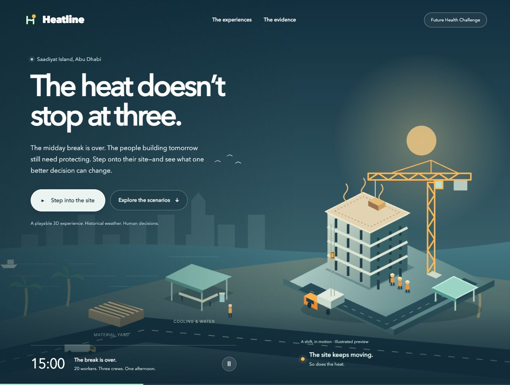
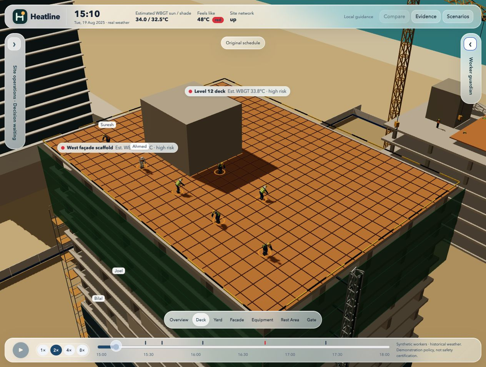
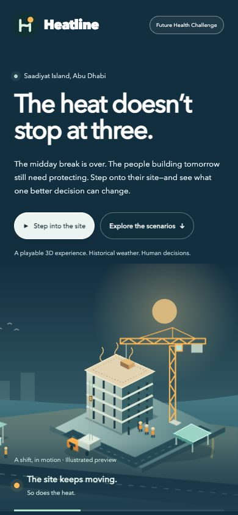
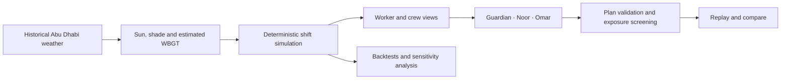

<div align="center">
  
  <h1>Heatline</h1>
  <p><strong>The heat doesn’t stop at three.</strong></p>
  <p>A playable construction site. A changing climate. One better decision.</p>
  <p>
    
    
    
    
  </p>
  <p><a href="#-take-the-supervisors-seat">Try the demo</a> · <a href="docs/pitch-script.md">Read the pitch</a> · <a href="docs/demo-flow.md">Demo flow</a> · <a href="#-run-it-locally">Run locally</a> · <a href="docs/scientific-basis.md">Explore the science</a></p>
</div>



The midday break is over. A concrete truck is on its way. One worker is new to the heat; another has a failing sensor. The afternoon still has to be planned.

**Heatline puts you in the supervisor’s seat.** Explore a fictional Abu Dhabi construction site driven by historical weather, listen to workers’ stories, review a plan, and rewind the same shift to see what changes. It is a worker-first heat-safety planning and training prototype built for the **Future Health Digital Innovation Challenge — Climate-Resilient Worker Health**.

## ☀️ A site with people in it

| Experience | What you can do |
| --- | --- |
| **Walk into the afternoon** | Explore the 3D tower, crane, construction lift, rebar yard, shaded rest areas, and site gate. |
| **Explore on foot** | Open a separate playground: walk the site, ride the construction lift to level 12, and rotate the crane, trolley and hook. The running shift is unchanged. |
| **Make room for the scene** | Minimize either glass side panel independently and switch between named camera views. |
| **Hear the worker’s side** | Preview multilingual guidance for six featured characters, including sensor-free fallback guidance. |
| **Plan with Omar** | Ask for a revised shift, inspect the policy checks and independent exposure screen, then choose whether to run it. |
| **Keep the crew in view** | Noor summarizes crew needs; the worker guardian presents an individual’s guidance separately. |
| **Rewind the decision** | Compare branches of the same simulated shift rather than comparing unrelated days. |
| **Look beyond the good ending** | Open Evidence to inspect missed warnings, exposure screening, and sensitivity to model assumptions. |

The landing page has an animated panorama: moving trucks, a lifting crane, a construction elevator, workers heading toward shade, coastal water, and swaying palms. Motion can be paused and respects reduced-motion preferences.

## 🎬 Take the supervisor’s seat

A short path through the demo:

1. Start **The afternoon pour** in story mode.
2. Meet the crew and follow the shift to the planning decision.
3. Ask **Omar** for a plan. Read the checks, including any exposure-screen findings.
4. Run the proposed plan, then rewind and compare the two outcomes.
5. Open **Evidence** to see the month-long experiment and the assumptions behind it.

| Shift | The decision waiting for you |
| --- | --- |
| **The afternoon pour** | A booked concrete truck, an exposed deck, and a crew lead who wants to finish. |
| **Racing the midday break** | Façade work, a returning worker, and a pour that risks running into the break. |
| **The day nobody should pour** | A humid afternoon that challenges the decision to work at all. |
| **When everything fails** | Dead wearables, a network outage, and a dust storm. |

> **Device support:** The landing page and evidence views are responsive. The interactive 3D simulator supports desktop and laptop, with a window at least 1024 pixels wide. Mobile visitors receive a clear desktop notice when starting a shift.

<details>
<summary><strong>See the simulator and mobile landing page</strong></summary>



<div align="center">
  
</div>

</details>

On a phone, open [Anwar’s worker demo](https://heatline-plum.vercel.app/worker/index.html) and wait for **Ready for offline use**. Disconnect and reload, decline wearable sharing, read the Bengali warning, and confirm arrival in shade. For two devices, start a fresh shift on the [supervisor dashboard](https://heatline-plum.vercel.app/worker/supervisor.html) and use its worker link on the phone. Reconnect the phone to deliver the queued confirmation. Retries and replaying on the same browser count once per shift. Local development uses a temporary filesystem store; Vercel uses private Blob storage.

## 🌍 Live demo

**[Open Heatline](https://heatline-plum.vercel.app)** on desktop to enter the simulator.

Guardian, Noor, Omar and multilingual speech are enabled in the live deployment. Functional checks on **7 November 2026** confirmed model-generated responses, a checked planner result and valid speech audio.

Vercel hosts the web app and API functions. GitHub pushes to `main` deploy the production project automatically; other branches receive preview deployments. The deployment works in rules-only mode without an API key. To enable model-backed assistants and speech, configure `OPENAI_API_KEY` and optional model settings in Vercel project environment variables, then redeploy.

### Explore on foot — just for fun

Click **Explore on foot** directly on the landing page to enter a standalone playground without starting a shift or calling an assistant. You can also open it inside a scenario. Use **WASD** to walk, **Shift** to move faster, and drag to look; arrow keys also turn and walk. Approach the lift or crane base and press **E**, or use the on-screen shortcuts. Ride to level 12 and step onto the roof; in the crane, use **A/D** to rotate, **W/S** for the trolley, and **Q/E** for the hook. **Esc** returns to your shift.

This is a disposable copy of the visible site. Exploration has its own camera and machinery state, makes no assistant calls, and cannot modify workers, plans, outcomes or playback controls. The original simulation keeps its normal playback and decision pauses underneath.

## 🎤 Present Heatline

- **[Short pitch script](docs/pitch-script.md)** — about 75 seconds, with slide cues and the closing ask.
- **[Judges’ demo flow](docs/demo-flow.md)** — a 25-second first-person opening, a 35-second offline phone replay, then two minutes of AI and heat-safety decisions, with presenter lines and a backup plan.
- **[Google Slides](https://docs.google.com/presentation/d/1U0cnRU4kcdr1z3TvDzAg8BzZWnwEI871LIf-HcL61D0/edit)** — visual pitch, live AI screenshot and speaker notes. Deck access may require permission from its owner.

## 🚀 Run it locally

Requires **Node.js 22.12 or newer** and npm.

```bash
git clone https://github.com/mk-tdev/heatline.git
cd heatline
npm install
cp .env.example .env
npm run dev
```

Open **http://127.0.0.1:5183**. The API runs on port **8787**.

**No API key is required to explore the prototype.** Rules-only operation provides local guidance and a rules-based plan. To enable model-backed assistants, add `OPENAI_API_KEY` to your local `.env`; optional model and voice settings are documented in [.env.example](.env.example). Keep credentials local.

## 🧭 How the pieces fit



| Directory | Purpose |
| --- | --- |
| `apps/web` | React, Three.js / React Three Fiber, stories, glass panels, and evidence views |
| `packages/climate` | Historical weather processing, solar position, heat index, and WBGT calculations |
| `packages/sim` | Synthetic workers, site conditions, deterministic replay, and exposure screening |
| `packages/rules` | Configurable demonstration policy and plan validation |
| `packages/agents` | Role-specific context, structured assistant outputs, and fallback guidance |
| `packages/contracts` | Shared types and schemas |
| `server` | Assistant endpoints and speech integration |
| `tests` | Climate, physiology, rules, projections, scenarios, and regression checks |

## 🔬 Built to show its assumptions

Historical gridded weather is real. **The workers, physiology, and outcomes are synthetic.** This is a training and research prototype, not a clinically validated safety system.

- The configurable demonstration policy is **not a WBGT-to-TWL conversion or UAE compliance certification**.
- An independent **NIOSH exposure screen** can flag a plan that passes the demonstration policy.
- The evidence view includes missed warnings and sensitivity variants, so a favorable demo is not the whole story.
- Role-specific views demonstrate information separation with synthetic data; production authentication and worker consent management are not implemented.
- Translations, site operations, and clinical escalation require professional review before a pilot.

Read the [scientific basis and primary sources](docs/scientific-basis.md), [project status](docs/status.md), and [asset provenance](docs/assets-and-licenses.md). Generated photos are illustrative; the animated panorama is drawn in SVG.

## 🛠️ Verify and explore

```bash
npm run check       # TypeScript + unit/regression tests
npm run build       # Production web build
npm run backtest    # Regenerate the August experiment and sensitivity variants
```

The test suite currently contains **90 tests**. The backtest covers **31 days × 3 windows × 4 policies**, plus five sensitivity variants: **2,232 simulated shift-policy runs**. These are simulation results, not field-validation results.

The production build currently emits a large-bundle advisory for the 3D client. This remains a performance improvement opportunity.

---

<div align="center">
  <strong>Different stories. The same right to go home well.</strong><br />
  <sub>Heatline · Future Health Digital Innovation Challenge</sub>
</div>
