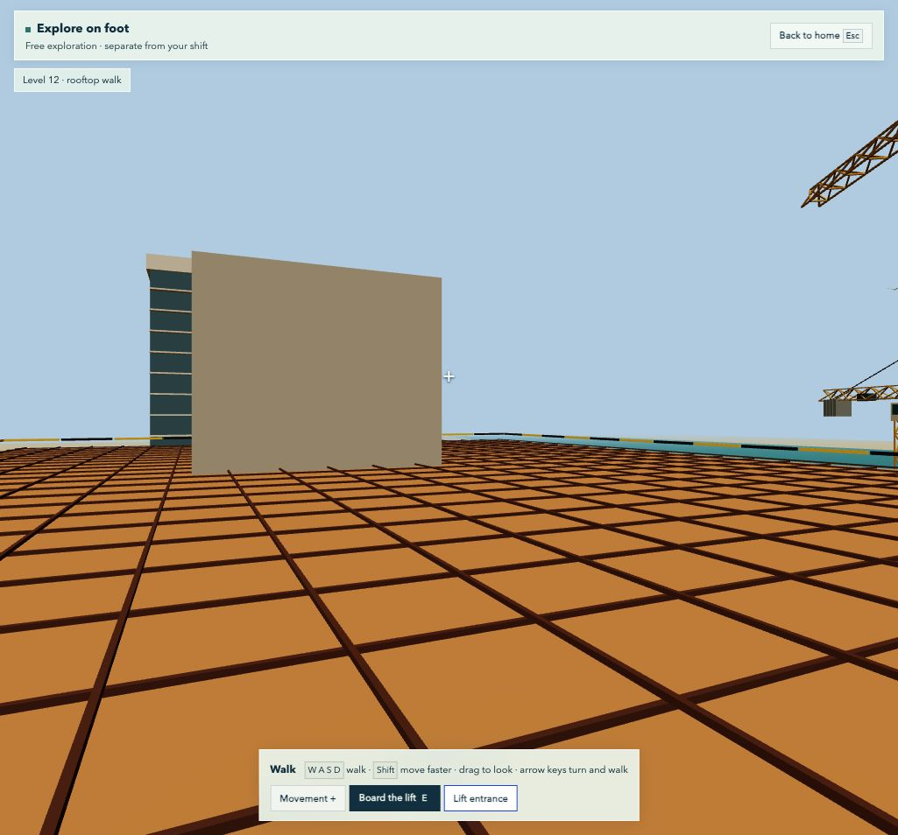

# Heatline — judges’ demo: first-person opening, then AI

A **25-second first-person opening**, a **35-second offline phone replay**, then **two minutes of AI and heat-safety decisions**. Total live-demo time: about three minutes.

Start with the site at human height. Then hear Anwar, watch Omar test a plan, and compare the shift.

[Open the live demo](https://heatline-plum.vercel.app) · [Pitch script](pitch-script.md) · [Google Slides](https://docs.google.com/presentation/d/1FMFLC-zGr_YUq21n0I0qrHFjGM7i1EPf86BKGodEv2A/edit)

## Three-minute recorded video (for the submission)

Updated 19 November 2026 for the feedback round. Judges will watch this without us in the room, so it opens with the problem and spends the most time on **Site watch**, the part built in response to their feedback. Total: about 3 minutes 10 seconds.

### Before you record (10 minutes)

1. **Browser.** Chrome, one window at 1920×1080 (or 1440×900), page zoom 100%. Close other tabs and turn off notifications. Use a clean profile so no extensions or bookmarks show.
2. **Open these tabs in order**, all on https://heatline-plum.vercel.app:
   - Tab 1: `/` (landing page)
   - Tab 2: `/#plan` (shift planner)
   - Tab 3: `/#watch` (site watch, replay mode)
   - Tab 4: `/` (for the 3D site; start it only when recording that segment)
3. **Warm up Site watch (important).** In tab 3, keep **The forecast was wrong**, set the speed to **4 min/s**, press ▶ and let it run from 10:00 to about 11:00, then drag the time slider back to **10:00**. Noor's briefs are stored in the page, so during the take she answers instantly. Do not reload tab 3 after this.
4. **Phone clip.** Record Anwar's phone separately (screen recording on the phone, about 20 s) and cut it in: open `/worker/supervisor.html` on the laptop, **Start a fresh demo shift**, scan the QR code, wait for **Ready for offline use**, turn the phone offline, tap **Decline sharing**, show the Bengali warning, tap **I reached shade**, reconnect, and show the laptop count going from 0 to 1.
5. **Omar clip.** Record the 3D segment once and keep the take: Omar's plan varies from run to run. Read out what the verdict card shows.
6. Check sound: a quiet room, a headset or clip-on microphone, and speak a little slower than feels natural.

### Shot list

| # | Time | Tab | Do this | Say this |
| --- | --- | --- | --- | --- |
| 1 | 0:00–0:15 | 1 Landing | Start on the hero. Scroll slowly to **The break ends. The heat does not.** and hold on the three figures. | “The UAE stops outdoor work from 12:30 to 3. Across the last two summers near Abu Dhabi, the heat was over the safe limit for steady work for 13 of 14 working hours a day. The break covers a fifth of them. That is real weather, not a simulation.” |
| 2 | 0:15–0:45 | 2 Planner | Click **Hottest day of summer 2026**. Point to the four cards, then the hour table. Change **Crews rest in** to **Shade only** (heavy work drops to nothing), then back to **A cooled room**. Click **বাংলা** in the crew briefing. | “The night before, Heatline turns the forecast for any site into work and rest limits for every hour, the coolest pour window, and a crew briefing in seven languages. Shade alone leaves no safe heavy work this afternoon; a cooled room gives twenty-five minutes an hour. It needs a location, nothing else.” |
| 3 | 0:45–1:10 | 3 Site watch | Point to **Site against the forecast: +2.8 °C** and the chart, where the station line runs above the dashed forecast. Then press ▶ (4 min/s). | “On the day, the forecast is not enough. This is a real day when the forecast issued the night before was three degrees too cool. A heat-stress station on the deck corrects it every minute, and Heatline tracks each crew’s last hour of heat and effort against the NIOSH limit.” |
| 4 | 1:10–1:40 | 3 | As crews A and B switch to **Indoor rotation**, pause (Ⅱ). In **Alerts**, open **Why?** on a **rotate at…** notice: show the numbered reasons and the chart with and without the rotation. Click **বাংলা**, then **العربية** in the crew broadcast. | “Fifteen minutes before a crew reaches its limit, Heatline moves it to indoor work in a cooled workshop, or calls a rest if that is not enough. Every alert says why, with the numbers, and the crew hears it in its own language.” |
| 5 | 1:40–2:00 | 3 | Scroll to **Noor on watch** and point to her latest brief. Then, in **Shift record**, click **Draft the record so far** and show the draft. | “Noor, our AI, watches the board and briefs the supervisor whenever something changes. At the end of the shift she drafts the safety record for the site file. She cannot change a break, and any number not on the board is rejected.” |
| 6 | 2:00–2:15 | 3 | Scroll up. Change **Site station** to **Fails 09:00–12:00**. Show the **Forecast only · +1 °C margin** badge and the **Site station offline** alert. | “If the station fails, Heatline says so and adds a safety margin. It never pretends to know.” |
| 7 | 2:15–2:35 | Phone clip | Play the recorded phone clip. | “Each worker gets the warning on their own phone, offline, with or without a wearable. The supervisor sees crew totals, never a name or a body reading.” |
| 8 | 2:35–2:55 | 4 3D site | **Step into the site** → at 15:10 **Ask Omar** → read the verdict card → **Run this simulated plan** → **Compare** (the recorded take). | “Before a plan reaches real people, we rehearse it on a 3D site with synthetic workers. Omar proposes; the site rules check every proposal and refuse the ones that break them.” |
| 9 | 2:55–3:10 | 3 Site watch | Scroll to **Across two summers: 186 real days** and point to the **Live, rotating to indoor tasks** row. End on **← Home** and the landing page. | “Across 186 real summer days: a fixed routine kept crews over the limit 84% of the time. Heatline, with a live station and indoor rotation, brings that under 3%, while crews stay productive 500 minutes a day. We are looking for one contractor and an occupational hygienist to pilot it next summer. Heatline. The same right to go home well.” |

### If something goes wrong while recording

- **Noor is slow or shows a rules summary:** keep going; the alerts are complete without her. Re-record shot 5 alone later and cut it in.
- **The weather service is slow in the planner:** click **Stored sample (offline)** and say “a stored day” instead of “the hottest day”.
- **Omar takes more than 20 seconds:** cut the waiting in the edit, or use the recorded take.
- **You scrub past a moment:** drag the slider back. The board recomputes instantly and nothing is lost.

### Exact numbers to quote (from the repository)

| Claim | Source |
| --- | --- |
| 13 of 14 working hours over the limit; 19% inside the break | `data/season/abu-dhabi-ban-season.json` (`npm run season`) |
| 84% → 2.6% time over the limit; 500 vs 513 productive minutes | `data/watch/evaluation.json` (`npm run eval:watch`) |
| Forecast up to 3.2 °C too cool on 25 Aug 2026 | `data/watch/replay-days.json` |
| AI checks (60 messages, 30 plans, 24 briefs, 8 records) | `docs/eval/README.md` |

Say “simulated workers” and “draft translations” once; judges value the honesty.

## Before presenting

- Use a desktop or laptop with a browser window at least 1024 pixels wide. Test the venue’s sound and connection.
- On the landing page, rehearse **Explore on foot → Lift entrance → Board the lift → Level 12 → Step out → Esc**. This standalone playground does not start a shift, call an assistant or change simulation outcomes.
- Confirm **Assistant connected**, a model attribution on the guidance, and a working **Listen** button.
- Use **Explore** under **The afternoon pour** for direct control. Story mode adds narrative pauses.
- Keep a second tab with a completed plan and comparison. Identify it as a prepared result if you use it.
- Rehearse once with the actual display and speakers. Model wording, plans and response times vary.

## Opening wow moment — 25 seconds

Show the cover slide, say **“Before we talk about heat, step onto the site with me,”** and switch to the live landing page.

| Time | Action | Presenter cue |
| --- | --- | --- |
| 0:00–0:05 | Click **Explore on foot** directly on the landing page. Drag briefly to look up at the tower. | “This is the worksite at human height.” |
| 0:05–0:18 | Click **Lift entrance → Board the lift → Level 12**. Look out through the cage while it rises. | “You can walk the site, ride the lift and operate the crane. This is a separate playground—no shift has started.” |
| 0:18–0:25 | Click **Step out** once the lift arrives. Glance across the rooftop, then press **Esc** or **Back to home**. | “That was the playground. Now let’s make a decision that matters.” |

Use the lift shortcut rather than spending the opening walking to it. Do not add a crane ride to the timed opening. If the lift takes longer on the presentation machine, exit at 25 seconds and continue; a rooftop arrival is not required to make the transition.

Return to slides **2–3** for the worker introduction and rooftop visual. Use slide **4** for the phone replay.

## Anwar’s phone — 35 seconds

Before presenting, open the [supervisor dashboard](https://heatline-plum.vercel.app/worker/supervisor.html) on the laptop and choose **Start a fresh demo shift**. Verify Crew B shows zero. Ask a judge to scan the QR code on the laptop with their phone camera and open the worker page while connected. If scanning is unavailable, use **Copy worker link**. Starting a fresh shift generates a new code. Wait for **Ready for offline use**. Keep the laptop connected.

1. Disconnect the phone from Wi-Fi and cellular data. Reload the worker page. Point out the offline indicator.
2. Tap **Decline sharing**. “Anwar can decline the wearable and still receive this warning.” Show the Bengali instruction to rest in shade and drink water. This replays a stored yellow warning from the morning shift at 09:40.
3. Tap **I reached shade** while offline. Show the queued receipt and the laptop count of zero. Reconnect the phone with the page open. When the phone shows **Delivered**, the dashboard refreshes to one within its next successful poll. “The supervisor sees one arrival in Crew B. The phone sent a random receipt. Anwar’s name, wearable choice and health readings stayed off the dashboard.”
4. At slide **5**, move to the connected laptop. “That was Anwar’s morning. Now the supervisor has an afternoon pour to plan.” If delivery is delayed, leave the receipt queued and return to the dashboard after the AI segment.

## AI and heat-safety sequence — two minutes

The times below restart at the beginning of this segment.

| Time | Action | Presenter cue |
| --- | --- | --- |
| 0:00–0:15 | From the landing page, choose **Explore** under **The afternoon pour**, then **Deck**. This starts the scenario, unlike the opening playground. | “This is the site behind the warning.” |
| 0:15–0:40 | Select **Anwar**, show his Bengali guidance and press **Listen**. Point to Noor’s crew-level brief while speech prepares. | “A warning only helps if the person understands it. This voice is AI-generated.” |
| 0:40–1:15 | At **15:10**, playback pauses for the decision. Press **Ask Omar** with the default concrete-truck question. Point to the conditions and planning tool calls as they appear. | “He checks conditions and tests a proposed plan against the rules.” |
| 1:15–1:40 | Read Omar’s verdict aloud, for example **“Allowed, and safer, but still too hot for part of the shift”**, and the line under it. If a plan was refused and revised, point to that step. | “Following the rules doesn’t make it safe. Heatline shows the heat that’s left.” |
| 1:40–2:00 | For an accepted plan, click **Run this simulated plan**, then **Compare**. Highlight minutes in high heat strain, time over the safe heat limit, and rest time. | “Same weather. Same people. One decision changed.” |

Read the actual displayed numbers. Do not promise a fixed reduction, a rejected plan, or a particular model response. A valid simulation plan may still leave substantial exposure concerns.

End with: **“We can inspect a decision before living with its consequences.”** Return to the deck for the evidence, partnership ask and closing.

## Optional Q&A moment — crane controls

From the landing page, use **Explore on foot → Crane base → Enter crane cab**. Hold **A/D** to rotate, **W/S** to move the trolley, and **Q/E** to raise or lower the hook. Press **Esc** to leave. Explain that these visual controls are separate from workers, schedules and heat-safety decisions. Keep this out of the main timed pitch.

## If something is slow or unavailable

- If first-person mode is slow, show slide 3 and move straight into the AI demo. Do not troubleshoot graphics on stage.
- While Omar works, explain the visible tool trace. After roughly 15 seconds of waiting, use the prepared comparison if needed and say it was generated during rehearsal.
- If the model is unavailable, label rules-based output as fallback. Do not present it as live AI.
- If no valid plan returns, show the refusal honestly and use the disclosed prepared result to explain comparison.
- If speech fails, read the English translation and continue. Do not spend the pitch debugging audio.
- If the phone was not prepared online, show slide 4 and describe the replay. Keep the laptop connected for the AI segment.

## Evidence boundaries

Historical weather drives synthetic workers and a teaching model. The prototype is not clinically validated or UAE safety certification. Role-specific views demonstrate information separation; production authentication and consent management are not implemented. See the [scientific basis](scientific-basis.md).

## Verified baseline — 12 November 2026

After the deployment of commit `e107b50`, the live shift planner loaded tomorrow’s forecast and the stored day, the landing page showed the real-weather finding, and the production guardian and planner returned model-written results (`gpt-6-luna`; the plan was accepted by the site rules). Speech was not re-checked.

## Earlier baseline — 7 November 2026

Production Guardian, Noor and Omar returned model-generated responses using `gpt-6-luna`. A planner test returned `check.ok: true`. Speech returned HTTP 200 with a valid MP3, and the browser showed the connected assistant, model attribution, Listen interaction and a completed planning flow. These are functional checks, not clinical validation or guarantees of future uptime. Production deploys automatically from GitHub `main`.

The standalone first-person entry was deployed in commit `a75cbe9`. Browser checks confirmed direct entry from the landing page and return home without mounting the simulation app.
