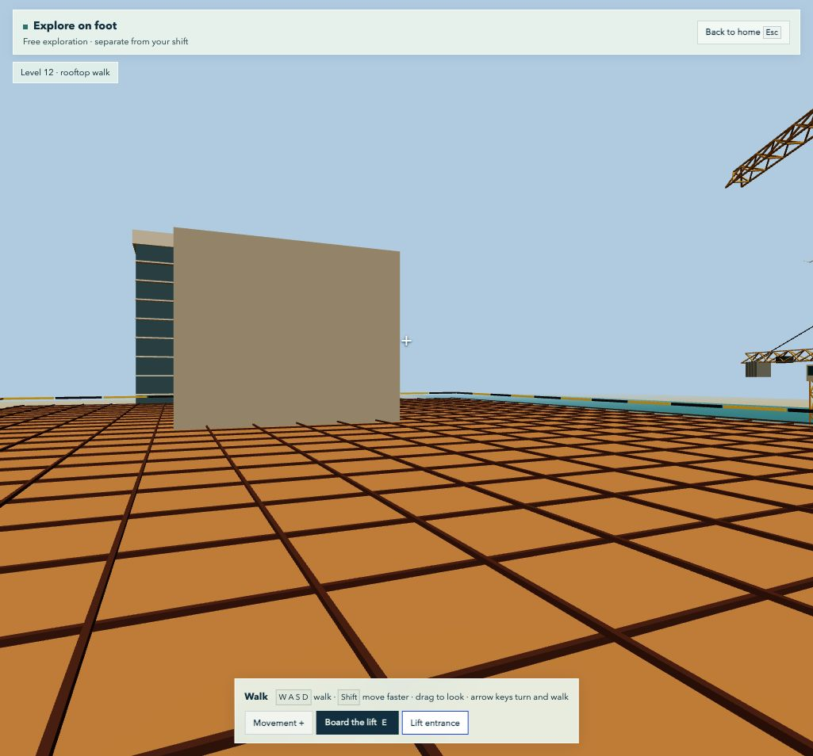

# Heatline — judges’ demo: first-person opening, then AI

A **25-second first-person opening**, a **35-second offline phone replay**, then **two minutes of AI and heat-safety decisions**. Total live-demo time: about three minutes.

Start with the site at human height. Then hear Anwar, watch Omar test a plan, and compare the shift.

[Open the live demo](https://heatline-plum.vercel.app) · [Pitch script](pitch-script.md) · [Google Slides](https://docs.google.com/presentation/d/1FMFLC-zGr_YUq21n0I0qrHFjGM7i1EPf86BKGodEv2A/edit)

## Three-minute recorded video (for the submission)

Judges will most likely watch this without us in the room, so it leads with the problem and the product. The live-room order further down still works for an in-person pitch.

| Time | On screen | Say |
| --- | --- | --- |
| 0:00–0:20 | Landing page hero, then scroll to **The break ends. The heat does not.** | “The UAE stops outdoor work from 12:30 to 3. Across the last two summers, the heat near Saadiyat was over the safe limit for steady work for 13 of 14 working hours a day. The break covers a fifth of them. This is real weather, not a simulation.” |
| 0:20–1:05 | **Plan tomorrow’s shift**. Pick **Hottest day of summer 2026**. Point to the four cards, the chart, the hour table. Switch **Crews rest in** to **Shade only** and back. Open the briefing in Bengali, then Arabic. | “Heatline turns a forecast for any site into work and rest limits for every hour. With shade alone, there is no safe heavy work that afternoon. With a cooled room, twenty-five minutes an hour. It finds the coolest pour window and writes the crew briefing in seven languages. It needs a location. No wearables, no worker data.” |
| 1:05–1:35 | Phone recording of Anwar’s page: offline indicator, **Decline sharing**, the Bengali warning, **I reached shade**, then the dashboard count going from 0 to 1. | “On the day, each worker gets a warning in their own language, offline, with or without a wearable. The supervisor sees one more person in shade. Not his name, not his readings.” |
| 1:35–2:30 | 3D site, **Explore** under **The afternoon pour**, **Deck** view. At 15:10 press **Ask Omar**. Show the steps, then the verdict card. **Run this simulated plan**, then **Compare**. | “Before a plan reaches real people, we rehearse it. Twenty synthetic workers, a real August afternoon, a truck on its way. Omar proposes; the site rules check every proposal and refuse the ones that break them. Read the verdict as shown. Then the same afternoon, one decision changed.” |
| 2:30–2:50 | **Evidence**: part 1, then the AI check numbers in the README. | “We tested the AI under pressure: thirty plans, none that broke a rule reached the supervisor. Sixty messages in six languages, all kept the action the rules chose.” |
| 2:50–3:00 | Landing page, **A pilot for summer 2027**. | “This is a prototype with simulated workers and draft translations. We are looking for one contractor and an occupational hygienist to pilot it next summer. Heatline. The same right to go home well.” |

Recording notes. Record at 1280×720 or larger with the browser zoomed so text is readable. Record Omar once and keep the take: his answer varies from run to run, and in our checks the headline question was answered with a 15:30 pour once and a cancelled pour twice. Read out whatever the card shows. The planner’s **Stored sample (offline)** button works with no connection if the weather service is slow. Keep the first-person walk and the crane for questions, not the video.

## Before presenting

- Use a desktop or laptop with a browser window at least 1024 pixels wide. Test the venue’s sound and connection.
- On the landing page, rehearse **Explore on foot → Lift entrance → Board the lift → Level 12 → Step out → Esc**. This standalone playground does not start a shift, call an assistant or change simulation outcomes.
- Confirm **Assistant connected**, a model attribution on the guidance, and a working **Listen** button.
- Use **Explore** under **The afternoon pour** for direct control. Story mode adds narrative pauses.
- Keep a second tab with a completed plan and comparison. Identify it as a prepared result if you use it.
- Rehearse once with the actual display and speakers. Model wording, plans and response times vary.

## Opening wow moment — 25 seconds

Show the cover slide, say **“Before we talk about heat, step onto the site with me,”** and switch to the live landing page.

| Time | Action | Presenter cue |
| --- | --- | --- |
| 0:00–0:05 | Click **Explore on foot** directly on the landing page. Drag briefly to look up at the tower. | “This is the worksite at human height.” |
| 0:05–0:18 | Click **Lift entrance → Board the lift → Level 12**. Look out through the cage while it rises. | “You can walk the site, ride the lift and operate the crane. This is a separate playground—no shift has started.” |
| 0:18–0:25 | Click **Step out** once the lift arrives. Glance across the rooftop, then press **Esc** or **Back to home**. | “That was the playground. Now let’s make a decision that matters.” |

Use the lift shortcut rather than spending the opening walking to it. Do not add a crane ride to the timed opening. If the lift takes longer on the presentation machine, exit at 25 seconds and continue; a rooftop arrival is not required to make the transition.

Return to slides **2–3** for the worker introduction and rooftop visual. Use slide **4** for the phone replay.

## Anwar’s phone — 35 seconds

Before presenting, open the [supervisor dashboard](https://heatline-plum.vercel.app/worker/supervisor.html) on the laptop and choose **Start a fresh demo shift**. Verify Crew B shows zero. Ask a judge to scan the QR code on the laptop with their phone camera and open the worker page while connected. If scanning is unavailable, use **Copy worker link**. Starting a fresh shift generates a new code. Wait for **Ready for offline use**. Keep the laptop connected.

1. Disconnect the phone from Wi-Fi and cellular data. Reload the worker page. Point out the offline indicator.
2. Tap **Decline sharing**. “Anwar can decline the wearable and still receive this warning.” Show the Bengali instruction to rest in shade and drink water. This replays a stored yellow warning from the morning shift at 09:40.
3. Tap **I reached shade** while offline. Show the queued receipt and the laptop count of zero. Reconnect the phone with the page open. When the phone shows **Delivered**, the dashboard refreshes to one within its next successful poll. “The supervisor sees one arrival in Crew B. The phone sent a random receipt. Anwar’s name, wearable choice and health readings stayed off the dashboard.”
4. At slide **5**, move to the connected laptop. “That was Anwar’s morning. Now the supervisor has an afternoon pour to plan.” If delivery is delayed, leave the receipt queued and return to the dashboard after the AI segment.

## AI and heat-safety sequence — two minutes

The times below restart at the beginning of this segment.

| Time | Action | Presenter cue |
| --- | --- | --- |
| 0:00–0:15 | From the landing page, choose **Explore** under **The afternoon pour**, then **Deck**. This starts the scenario, unlike the opening playground. | “This is the site behind the warning.” |
| 0:15–0:40 | Select **Anwar**, show his Bengali guidance and press **Listen**. Point to Noor’s crew-level brief while speech prepares. | “A warning only helps if the person understands it. This voice is AI-generated.” |
| 0:40–1:15 | At **15:10**, playback pauses for the decision. Press **Ask Omar** with the default concrete-truck question. Point to the conditions and planning tool calls as they appear. | “He checks conditions and tests a proposed plan against the rules.” |
| 1:15–1:40 | Read Omar’s verdict aloud, for example **“Allowed, and safer, but still too hot for part of the shift”**, and the line under it. If a plan was refused and revised, point to that step. | “Following the rules doesn’t make it safe. Heatline shows the heat that’s left.” |
| 1:40–2:00 | For an accepted plan, click **Run this simulated plan**, then **Compare**. Highlight minutes in high heat strain, time over the safe heat limit, and rest time. | “Same weather. Same people. One decision changed.” |

Read the actual displayed numbers. Do not promise a fixed reduction, a rejected plan, or a particular model response. A valid simulation plan may still leave substantial exposure concerns.

End with: **“We can inspect a decision before living with its consequences.”** Return to the deck for the evidence, partnership ask and closing.

## Optional Q&A moment — crane controls

From the landing page, use **Explore on foot → Crane base → Enter crane cab**. Hold **A/D** to rotate, **W/S** to move the trolley, and **Q/E** to raise or lower the hook. Press **Esc** to leave. Explain that these visual controls are separate from workers, schedules and heat-safety decisions. Keep this out of the main timed pitch.

## If something is slow or unavailable

- If first-person mode is slow, show slide 3 and move straight into the AI demo. Do not troubleshoot graphics on stage.
- While Omar works, explain the visible tool trace. After roughly 15 seconds of waiting, use the prepared comparison if needed and say it was generated during rehearsal.
- If the model is unavailable, label rules-based output as fallback. Do not present it as live AI.
- If no valid plan returns, show the refusal honestly and use the disclosed prepared result to explain comparison.
- If speech fails, read the English translation and continue. Do not spend the pitch debugging audio.
- If the phone was not prepared online, show slide 4 and describe the replay. Keep the laptop connected for the AI segment.

## Evidence boundaries

Historical weather drives synthetic workers and a teaching model. The prototype is not clinically validated or UAE safety certification. Role-specific views demonstrate information separation; production authentication and consent management are not implemented. See the [scientific basis](scientific-basis.md).

## Verified baseline — 12 November 2026

After the deployment of commit `e107b50`, the live shift planner loaded tomorrow’s forecast and the stored day, the landing page showed the real-weather finding, and the production guardian and planner returned model-written results (`gpt-6-luna`; the plan was accepted by the site rules). Speech was not re-checked.

## Earlier baseline — 7 November 2026

Production Guardian, Noor and Omar returned model-generated responses using `gpt-6-luna`. A planner test returned `check.ok: true`. Speech returned HTTP 200 with a valid MP3, and the browser showed the connected assistant, model attribution, Listen interaction and a completed planning flow. These are functional checks, not clinical validation or guarantees of future uptime. Production deploys automatically from GitHub `main`.

The standalone first-person entry was deployed in commit `a75cbe9`. Browser checks confirmed direct entry from the landing page and return home without mounting the simulation app.
