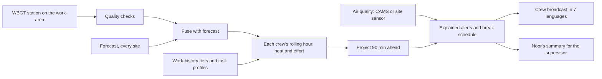

# Site watch: live telemetry and proactive breaks

Written 17 November 2026, in response to early reviewer feedback. Open it at [heatline-plum.vercel.app/#watch](https://heatline-plum.vercel.app/#watch) (any screen).

## What the reviewers asked for, and what is now built

| Feedback | What Heatline now does | Where |
| --- | --- | --- |
| Integrate live site telemetry: real-time WBGT, humidity, radiant heat, air quality | A WBGT station on the work area posts readings (WBGT, or globe, natural wet-bulb and air temperature, which give WBGT by ISO 7243; humidity, wind, PM10, PM2.5). Readings are quality-checked and fused with the forecast every minute. Air quality comes from the CAMS model for any site, and from a site PM sensor when there is one. Meter exports can be dropped in as a CSV | `POST /api/telemetry`, **Live today** board, `packages/sim/src/station.ts` |
| Dynamic worker acclimatisation and task intensity profiles | Each worker's limit and daily heat-time cap come from their days in the heat (new: 20% building to full; back after a week away: 50/60/80/100%; four weeks away: start again). Tasks carry metabolic-rate estimates (rebar tying 415 W, façade fixing 300 W, inspection 180 W). The scheduler applies the unacclimatised limit and the cap to the right group | `packages/sim/src/profiles.ts` |
| An AI assistant that continuously analyses microclimate and crew exposure trends | Every minute the scheduler tracks each crew's last hour of heat and effort against the NIOSH limit and projects 90 minutes ahead. **Noor on watch** briefs the supervisor on her own whenever the board changes significantly (about 4 times a day), using the board's own projections. **The shift recorder** drafts the end-of-shift heat-safety record for the site file | **Noor on watch** and **Shift record** panels |
| Proactive, climate-aware alerts that recommend hydration, rotation or rest before hazardous thresholds | Relief is announced 15 minutes before the crew would reach its limit, with its length, place and a cup of water. The scheduler first tries **task rotation** to the crew's indoor task in a cooled workshop, and falls back to rest only when rotation would not bring exposure down. The scheduler moves a crew from shade to the cooled room when shade is too hot to recover in, brings breaks forward when the site runs hotter than forecast, moves new workers indoors at their cap, and raises dust measures | Alert feed |
| Clear, explainable warnings | Every alert opens to numbered reasons (heat now and its source, the crew's last hour, the limit that applies, when the limit would be crossed) and a chart of the next hour with and without the break. Each crew alert has a fixed broadcast in seven languages | **Why?** on any alert |
| Strictly safeguard individual worker data | The board receives crews, tasks, places, clothing and work-history tiers. It never receives a name, a body reading or anyone's location; body data stays on the worker's own phone. An automated test checks every alert and every minute for names and body readings | Privacy panel; `tests/watch.test.ts` |

## How it works



1. **Telemetry.** Readings are rejected if they have no WBGT, are physically implausible, duplicate a minute, or jump more than 3 °C within five minutes. The station is assumed to stand in the sun on the work area, as OSHA advises for WBGT meters.
2. **Fusion.** The difference between the station and the forecast over the last 30 minutes is added to the forecast, fading over three hours into the future. If the station goes quiet for 10 minutes, its last correction fades and 0.5 °C is added; after 45 minutes the board falls back to the forecast with 1 °C added, and says so.
3. **Exposure.** For each crew group, the last 60 minutes of WBGT where they were (work area, rest area, clothing adjustment) and of metabolic rate are averaged, as NIOSH 2016-106 prescribes, and compared with the NIOSH limit for that average workload: the recommended limit for acclimatised workers, the stricter one for workers still building up.
4. **Scheduling.** A crew works while the next minute keeps its rolling hour under the limit; it rests for at least 10 minutes and resumes only when 15 further minutes of work would stay under. Projecting this forward gives the next break's time and length, announced 15 minutes ahead. An announced break is binding; if the site turns hotter, the break is moved earlier and the move is announced.
5. **Alerts.** Break notices are schedule updates; the alerts to act on are moved breaks, breaches, a crew whose shade is too hot, a heat-time cap, a failed station, and dust. Dust is smoothed over 15 minutes and only steps down after 30 minutes clearly below its band, so it does not flicker.

## How well it works: two summers of real weather

Every day from 15 June to 15 September in 2025 and 2026 (186 days), three crews of the demonstration site. The scheduler only ever sees the forecast issued the day before (Open-Meteo's archive of past forecasts) and, when present, the station. "Over the limit" is measured on the site's actual conditions. `npm run eval:watch` regenerates `data/watch/evaluation.json`.

| How breaks are timed | Time over the limit | Over the limit, per worker a day | Work, per worker a day | Breaks announced ≥10 min ahead | Alerts to act on, per day |
| --- | --- | --- | --- | --- | --- |
| Fixed routine: 50 min work, 10 min rest | 84.2% | 531 min | 513 min | — | 7.3 |
| Breaks from the day-ahead forecast only | 36.3% | 229 min | 374 min | 99.9% | 1.4 |
| Day-ahead forecast with Heatline's +1 °C margin | 10.0% | 63 min | 351 min | 99.8% | 1.3 |
| **Live: site station fused with the forecast** | **1.9%** | **12 min** | **364 min** | **99.5%** | **2.1** |
| Live, with the station down 09:00–12:00 every day | 5.5% | 35 min | 363 min | 99.1% | 3.4 |
| **Live, rotating to indoor tasks before resting** | **2.6%** | **17 min** | **500 min** (338 main task + 163 indoor rotation) | **99.1%** | **2.7** |

What this shows:

- **Live readings are what make proactive breaks work.** Timed from the forecast alone, crews were over the limit a third of the time, because sites run hotter than an area forecast. A safety margin helps but costs work. The station brings time over the limit down to 2% while crews work more than with the margin.
- **It degrades safely.** With the station failing for three hours every day, time over the limit stays at 5.5%.
- **Rotation makes safety nearly cost-free.** Rest-only breaks keep crews inside the limit but cost about 150 minutes a day against the fixed routine. Rotating crews to indoor tasks in a cooled workshop (rebar cutting, formwork preparation, panel sealing) before resting keeps them productive for 500 minutes a day, against 513 on the fixed routine, with time over the limit at 2.6% instead of 84%.
- **Rotation in shade does not work in this heat.** Shade alone is above the NIOSH limit for steady moderate or light work most summer hours. The scheduler only rotates to a task that is itself within its limit, so with shaded rotation tasks it rotated for about 4 minutes a day and rested otherwise. Sites need cooled indoor work to rotate to.
- **Alerts stay readable.** About two to three alerts a day call for action across the site. Break notices (about 13 per crew group a day in deep summer) are schedule updates, not alarms.

The forecast on its own: against reanalysis, the day-ahead WBGT forecast in the sun was off by 0.7 °C on average and too cool by more than 1 °C in 3.6% of working hours. The shift planner built on it allowed more heavy work than the actual weather would in 6.8% of hours (never by 10 minutes or more), and in 0.6% with a 1 °C margin.

Dust: in 2,046 shift hours, modelled PM10 was elevated (≥155 µg/m³) in 377, unhealthy (≥255) in 44 and severe (≥355) in 14, on 92 of 186 days.

**Assumptions.** The forecast and reanalysis are real archives. The site effects are not measurements: the site is taken to run 0.3 °C hotter than the grid square, up to 0.9 °C more in strong sun, with a day-to-day offset (SD 0.4 °C) and a slow wander (SD 0.25 °C); the station reads the site with 0.2 °C noise. These stand in for what a pilot would measure. The crews, tasks and metabolic rates are the demonstration site's.

## Task rotation

Each crew has an indoor task in a cooled workshop or store (rebar cutting and bending; formwork and fixings preparation; panel sealing and inspection), with its own metabolic-rate estimate. When a crew needs relief, the scheduler rotates it to that task only if the task is sustainable in current conditions (its own heat and effort at least 0.5 °C under its NIOSH limit) and the rotation minute keeps the rolling hour under the limit. Otherwise the crew rests, and stays resting until the main task resumes, so it never flips between the two. The announcement says which it will be ("rotate at 10:07 for 36 min" or "break at…"), and the crew broadcast says "move to your indoor task" in seven languages.

## Three AI roles, each checked

| Role | What it does | What it cannot do | How it is checked |
| --- | --- | --- | --- |
| **Noor on watch** | Briefs the supervisor automatically when the board changes significantly (alerts to act on, station dropping or returning, site hotter than forecast, dust, rest moved, caps), at least 20 minutes apart: about 4 briefs a day, at most 8 | Change a break, rotation or time; see individuals | Rejected if it mentions a time, crew or name not on the board; 24 recorded briefs |
| **Shift recorder** | Drafts the end-of-shift heat-safety record for the site file: summary, what went well, concerns, actions for tomorrow, crew figures. A manager reviews and signs | Add a number not in the crew-level figures; name anyone; call the shift safe or compliant | Every number checked against the figures; 8 recorded records |
| **Guardian** (worker phone) and **Omar** (planner) | Word each worker's warning in their language; propose plans the site rules check | Change the action the rules chose; skip the rules | 60 messages, 30 plans recorded |

## The AI's part, and how it is checked

Noor reads the crew-level board (one entry per crew group: status, share of the limit now and projected in 30 minutes, next break and its length, rest place) plus the forecast now and in an hour and the last 30 minutes of alerts. She writes a headline, up to three priorities and a trend. Her output is rejected and replaced with the rules' own summary if it mentions a time, crew or name not on the board, or claims safety.

In 24 recorded moments across the four replay days ([record](eval/README.md#noors-site-watch-briefs)), 23 briefs passed the checks (the other was replaced by the rules summary) and a separate judge, reading the same board text, found 21 fully supported. One repeated a station-offline instruction after the station had come back; that is a known weakness. Earlier rounds of this test found and fixed real problems in the board itself: an announced break time could drift by a minute, and crews with workers on two limits were merged into one line.

## Connecting a real station

```bash
curl -X POST https://heatline-plum.vercel.app/api/telemetry \
  -H 'content-type: application/json' -H 'x-heatline-site: <station id>' \
  -d '{"readings":[{"at":"2027-07-14T10:05","wbgt":31.4,"ta":38.2,"rh":41,"tg":52.0,"pm10":120}]}'
```

- A station ID is a random UUID made on the **Live today** board. Anyone holding it can post and read that site's readings, like the shift links; a pilot would add per-site keys.
- Up to 120 readings per request; one reading per minute per site is kept (24 hours).
- Without a meter, `npm run station:sim -- --site <station id> --backfill` posts a real August day's site readings at today's clock.
- Meters that only export files can use **Import CSV**: columns are matched by name (time, WBGT, globe, natural wet-bulb, air temperature, humidity, wind, PM10, PM2.5), Fahrenheit is converted, and only today's rows are used.

## Limits

- NIOSH limits are screening limits for healthy workers. Abu Dhabi's Safety in the Heat code asks for a Thermal Work Limit assessment by a competent person; a pilot would compare both on site.
- One station per work area is assumed. Crews in shade or at height need their own reading or a measured offset.
- Workload estimates are class averages per task, not measurements. Rest-room conditions (21 °C WBGT) are assumed.
- The scheduler assumes crews take announced breaks. Whether they do, and whether supervisors act on alerts, is what the pilot must measure.
- Dust bands use EPA PM10 breakpoints on short averages; respirators add strain, which the scheduler does not yet model.
